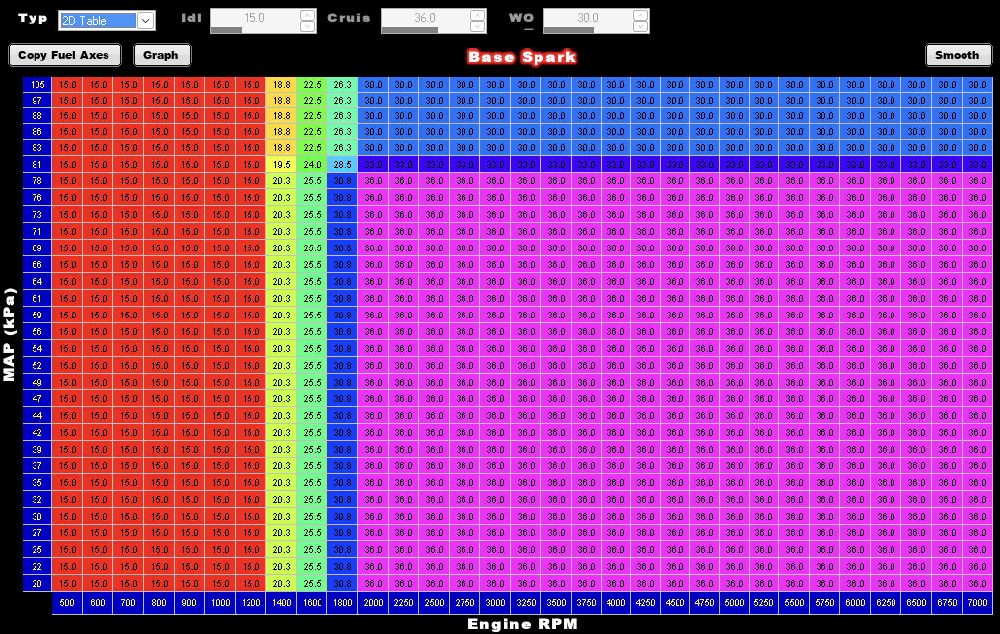

# Sniper → Terminator X Spark Table Converter

Holley's Terminator X software won't import a `.spark` (base spark table) file saved from Sniper EFI software, even though the two programs share most of the same code. This script converts a Sniper `.spark` file into the Terminator X format, so you can import a timing table someone shared from a Sniper setup.



*The Base Spark screen in Terminator X. The converter brings over the Idle, Cruise and WOT targets, the table and both axes.*

> **Not affiliated with Holley.** This is an independent, community-made tool. The file format was worked out by comparing files, not from any documentation.
>
> **Use at your own risk.** The authors assume **no responsibility** and make **no guarantees** about the output. **You** are responsible for verifying every value in your tune before using it on your vehicle. See the full [Disclaimer](#disclaimer).

---

## Compatibility

Tested with:

| | Sniper (input) | Terminator X (template) |
|---|---|---|
| Software version | 2.0.15 | 3.0.110 |
| File type | `.spark` (Base Spark table export) | `.spark` (Base Spark table export) |
| Format version (stored in the file) | 2 | 3 |
| File size | 4,628 bytes | 5,028 bytes |
| Table size | 31 × 31 (MAP × RPM) | 31 × 31 (MAP × RPM) |

The script checks the format version and file size of both files. If either doesn't match, it stops with an error and writes nothing. Other software versions that save the same format should work, but haven't been tested. Other table types (fuel, AFR target and so on) **are not supported**.

If it works or fails with your software versions, please open an issue and include the version numbers.

## Requirements

- Python 3.6 or newer. It uses only the standard library, so you don't need to install anything else.
  - On Windows, install Python from [python.org](https://www.python.org/downloads/) and tick **Add python.exe to PATH** during setup.
- Runs on Windows, macOS and Linux.
- A **template file**: any `.spark` file saved from **your own** Terminator X software. Your current base spark table is the obvious choice. The template is only read, never changed.

## Quick start (Windows, drag and drop)

1. Download `convert_spark.py` and `convert_spark.bat` into the same folder.
2. In Terminator X, save your current base spark table into that folder as **`template.spark`**.
3. Drag one or more Sniper `.spark` files onto `convert_spark.bat`.
4. A converted file named `<original-name>_terminator.spark` appears next to each Sniper file. The window shows the Idle, Cruise and WOT targets of each converted file, then waits for a key press.

## Command line (any OS)

```
python3 convert_spark.py SNIPER_FILE.spark [TEMPLATE.spark] [OUTPUT.spark]
```

| Argument | Description |
|---|---|
| `SNIPER_FILE.spark` | The Sniper file you want to convert. |
| `TEMPLATE.spark` | Optional. A `.spark` file saved from your Terminator X software. Defaults to `template.spark` in the same folder as the script. |
| `OUTPUT.spark` | Optional. Defaults to `<sniper-file-name>_terminator.spark` in the same folder as the Sniper file. |

On Windows, use `py` or `python` instead of `python3`.

Example:

```
$ python3 convert_spark.py shared_timing.spark my_current_spark.spark
Wrote shared_timing_terminator.spark
Idle 15.0  Cruise 36.0  WOT 30.0
```

The output can't overwrite either input file, so your template is always safe.

### Preview a file before importing

`--show` prints a file's timing targets, axes and full table, laid out like the software screen (highest MAP at the top). It works with both Sniper and Terminator X files and doesn't change anything:

```
$ python3 convert_spark.py --show shared_timing.spark
shared_timing.spark  (Sniper format)
Idle 15.0  Cruise 36.0  WOT 30.0
RPM 500-7000   MAP 20-105 kPa

 105 | 15.0 15.0 15.0 15.0 15.0 15.0 15.0 18.8 22.5 26.3 30.0 30.0 ...
  97 | 15.0 15.0 15.0 15.0 15.0 15.0 15.0 18.8 22.5 26.3 30.0 30.0 ...
 ...
  20 | 15.0 15.0 15.0 15.0 15.0 15.0 15.0 20.3 25.5 30.8 36.0 36.0 ...
     +------------------------------------------------------------
 RPM    500  600  700  800  900 1000 1200 1400 1600 1800 2000 2250 ...
```

The table is about 160 characters wide, so widen your terminal window to see it all. You can pass several files at once to compare them.

## After importing: required steps

1. **Back up first.** Save your current spark table under a different name before you import anything.
2. **Import the converted file** in Terminator X in the usual way.
3. **Match the axes to your setup.** A Sniper table may use different MAP points, or stop at a lower RPM than your engine reaches. For example, a table that ends at 5500 RPM will run its last column's timing at every RPM above that. Click **Copy Fuel Axes** on the Base Spark screen to apply your fuel table's MAP and RPM axes to the spark table. Then look over the table, especially any columns beyond the original table's RPM range.
4. **Check Idle, Cruise and WOT.** These three timing targets come from the Sniper file along with the table. Make sure they suit your engine.
5. **Check the other spark settings** (see warnings below), then save and write to the ECU.

## What gets converted

| Data | Taken from |
|---|---|
| Idle, Cruise and WOT timing targets | Sniper file |
| 31 × 31 base spark table | Sniper file |
| MAP (kPa) and RPM axes | Sniper file |
| Other spark settings stored in the file | Sniper file |
| Product signature (first 4 bytes) | Template |
| Terminator-only data (two flags, an empty data block, and the Rev Limiter / Launch Retard entries) | Template |
| Version number and length fields | Set by the script |

## ⚠️ Warnings

- **Timing that is too aggressive can destroy an engine.** Another engine's table reflects its compression, cam, fuel, altitude and many other factors. Use it as a starting point, not a finished tune. Watch for knock and be conservative.
- **Some settings may mean something different.** The file holds a few values outside the main table that come over from the Sniper file as they are. In testing, one of them (probably an RPM limit) and one 16-point table had noticeably different values or ranges between the two programs. The Terminator software may read these differently. After import, look through every spark-related screen and correct anything that doesn't fit your setup.
- **Your template's Terminator-only settings carry over.** The Rev Limiter and Launch Retard entries in the output come from your template file, not from the Sniper file.
- **Tested on a small sample.** The layout was worked out from one pair of files. Future software updates could change the format.

## Troubleshooting

| Problem | Likely cause |
|---|---|
| `Sniper file: expected v2 / 4628 bytes…` | The input isn't a Sniper base spark file, or it comes from a software version with a different layout. If it says `v3`, it is already in Terminator format and should import directly. |
| `Template file: expected v3 / 5028 bytes…` | The template isn't a Terminator X base spark file. Save your current spark table from Terminator X and use that. |
| `Template not found…` | There's no `template.spark` next to the script and no template was given. See [Quick start](#quick-start-windows-drag-and-drop). |
| `Python 3 was not found` (Windows) | Install Python from python.org with **Add python.exe to PATH** ticked, then try again. |
| The `.bat` window flashes and closes | Run `convert_spark.bat` from a Command Prompt to see the error message. |
| Terminator X refuses the converted file | The template may come from a different Terminator software version than the one doing the import. Save a fresh template from the same software and try again. |

## How it works (file format notes)

All values are little-endian. Floats are 32-bit IEEE 754.

| Offset | Size | Contents |
|---|---|---|
| `0x0000` | 4 | Product signature. This is **not a checksum**: the software accepts any contents with the right signature. Sniper and Terminator X files use different values. |
| `0x0004` | 4 | Format version (Sniper = 2, Terminator X = 3) |
| `0x004C` | 4 | Constant `0xA1` |
| `0x0050` | 4 | Format version (repeated) |
| `0x0054` | 4 | Length of the data from `0x4C` to the end of the file |
| `0x005C` | 3 × float | Idle, Cruise and WOT timing targets |
| `0x0068` | 961 × float | 31 × 31 timing table, one MAP row at a time from lowest to highest MAP |
| `0x0F6C` | 31 × float | MAP axis (kPa) |
| `0x0FE8` | 31 × float | RPM axis |
| `0x1064` | … | Other spark settings, plus a 16-point table at `0x10D4` |
| `0x1114` | 0x108 | **Terminator X only:** two flags and 64 floats, inserted at this point |
| … | … | Two 16-point tables (−40 to 999) whose purpose is unknown. They were identical in both test files. |
| `0x131C` | to end of file | **Terminator X only:** Rev Limiter / Launch Retard entries |

To convert, the script copies the Sniper data, inserts the Terminator-only block at `0x1114`, adds the Terminator-only entries from the template at the end, copies the template's signature, and updates the version and length fields.

## Contributing

Reports of which software versions work (or don't), plus sample files from other versions, are the most useful contributions. If you know what the remaining unknown settings are, please share that too.

## Disclaimer

This tool is provided "as is", without warranty of any kind. The authors and contributors assume **absolutely no responsibility or liability** for the output of this tool, or for any damage to engines, vehicles or other property, or any injury, that results from using it or any file it produces. **No guarantee** is made that converted files are correct, complete, or safe to run.

It is **entirely the responsibility of the user** to check and verify every value in their tune, including timing targets, the spark table, axes and all other settings, before using it on any vehicle. If you aren't confident checking a tune yourself, have it reviewed by a qualified tuner.

Holley, Sniper and Terminator X are trademarks of their respective owners. This project is not affiliated with, endorsed by, or supported by Holley.

## License

[MIT](LICENSE)
